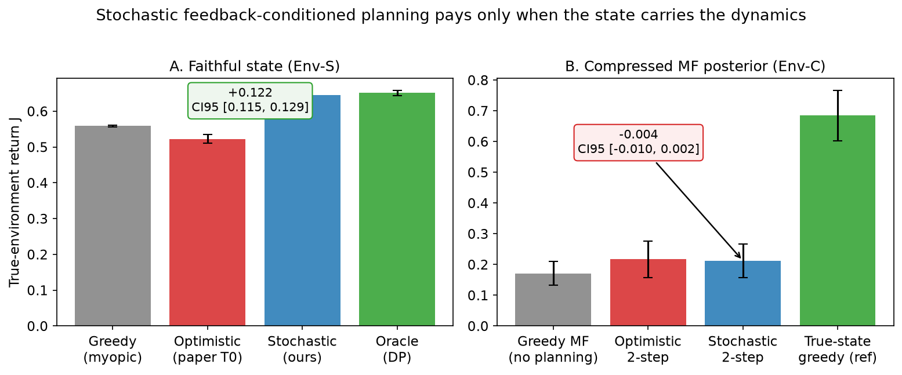

# Planning over MF-MDPs — reproduction and beyond

Research code for the project **"Beyond Optimistic Planning: Learning Stochastic User
Dynamics for Model-Based Sequential Recommendation"**, building on the reproduction of
*Planning over Matrix-Factorization MDPs for Candidate Generation*
([arXiv:2607.02115v2](https://arxiv.org/abs/2607.02115), KDD 2026 Workshop).

## Goal

Determine whether **feedback-conditioned stochastic user dynamics** improve
long-horizon recommendation decisions over the original **optimistic** MF-MDP
("every recommendation is accepted") — measured in controlled environments with known
true dynamics and exact oracles, as a function of state-representation fidelity,
planning depth, and response-model error. (RU version: `docs/STUDIO.md`.)

## Main result



Stochastic planning pays **only when the state carries the dynamics**: with a faithful
state it reaches the exact-oracle return (+0.122 over the optimistic planner,
CI95 [0.115, 0.129]); over the compressed MF posterior it does not differ from
optimistic (−0.004, CI95 [−0.010, 0.002]).

| Experiment | Result | Where |
|---|---|---|
| ML-1M LLN reproduction | Static dot .0704 (paper .0694, reproduced); planning gains NOT reproduced | [REPRODUCTION.md](docs/REPRODUCTION.md) |
| Leverage diagnostics | alignment term inert or harmful; leverage = popularity proxy | [PLANNING_DIAGNOSTICS.md](docs/PLANNING_DIAGNOSTICS.md) |
| Reward/value models (ML-1M) | learned rewards lose to the paper heuristic; V_logging ≈ mean predictor | [PHASE4_RESULTS.md](docs/PHASE4_RESULTS.md) |
| Env-S (faithful state) | **stochastic beats optimistic: +0.122, CI95 [0.115, 0.129]**; oracle regret 0.006 | [EXPERIMENT_LOG](docs/EXPERIMENT_LOG.md) |
| Env-C (MF posterior) | stochastic ≈ optimistic (−0.004); representation-bound | same |
| H3: depth × noise | deeper planning cuts regret 5–15× once the model is reasonable | `figures/h3_error_depth.png` |
| KuaiRand-1K response models | watch-ratio AUC 0.839 (transfers to randomized exposure); click policy-bound | `outputs/phase5/kuairand_response.json` |

## Quickstart

```bash
python3.11 -m venv .venv && .venv/bin/pip install -e '.[dev]'
.venv/bin/python -m pytest tests/            # 55 tests
.venv/bin/python run_experiment.py           # reproduce everything (~3-4 min)
.venv/bin/python run_experiment.py --fast    # smoke run (~40 s)
.venv/bin/python figures/make_figures.py     # rebuild figures from saved JSONs
```

The full pipeline runs Env-S checks/ablations/noise-grid + Env-C ablation, writes JSON
results to `outputs/`, and rebuilds `figures/` — computation and plotting are fully
separated (figures never re-run experiments).

## One-slide report

[studio/slide_main.pdf](studio/slide_main.pdf) — figure + key message + notations
(Scientific Studio week-8 format); talk script: [studio/ONE_MINUTE_SCRIPT_RU.md](studio/ONE_MINUTE_SCRIPT_RU.md).

## Repository layout

```
run_experiment.py        ← single entry point (all results + figures)
src/mf_mdp/              ← mf (iALS+fold-in), mdp (state/transition/reward),
                           planning (static/plan1/plank), models (response/reward/value),
                           data (movielens, kuairand), envs (Env-S, Env-C), evaluation
experiments/             ← reproduction, diagnostics, phase4, phase5 runners
figures/                 ← make_figures.py + rendered figures (tracked)
studio/                  ← one-slide report + generator (RU)
tests/                   ← 55 math/structure/environment tests
docs/                    ← research plan, reproduction, diagnostics, phase4/5 docs, logs
outputs/                 ← run artifacts (git-ignored)
```

## Documentation

- [RESEARCH_PLAN.md](docs/RESEARCH_PLAN.md) — research questions and phase map
- [REPRODUCTION.md](docs/REPRODUCTION.md) — reproduction protocol and verdict
- [PLANNING_DIAGNOSTICS.md](docs/PLANNING_DIAGNOSTICS.md) — leverage/alignment analysis (+ audit addendum)
- [PHASE4_RESULTS.md](docs/PHASE4_RESULTS.md) — reward/value model experiments
- [PHASE5_HYPOTHESES.md](docs/PHASE5_HYPOTHESES.md) / [PHASE5_EXPERIMENT_PLAN.md](docs/PHASE5_EXPERIMENT_PLAN.md) — frozen protocol
- [LITERATURE_REVIEW_PHASE5.md](docs/LITERATURE_REVIEW_PHASE5.md) — comparison table
- [STUDIO.md](docs/STUDIO.md) — course alignment (RU), experiment goal
- [EXPERIMENT_LOG.md](docs/EXPERIMENT_LOG.md) — every run with metrics

## Status notes

- MF hyperparameters of the starting paper are unreported; ours are validation-selected
  and documented in [DECISIONS.md](docs/DECISIONS.md).
- `V_logging` (logging-policy value) is never `V_target`; labeling contracts in
  [PHASE4_DESIGN.md](docs/PHASE4_DESIGN.md).
- KuaiRand-1K and MovieLens data are git-ignored (public datasets; see
  [DATASETS.md](docs/DATASETS.md)).
